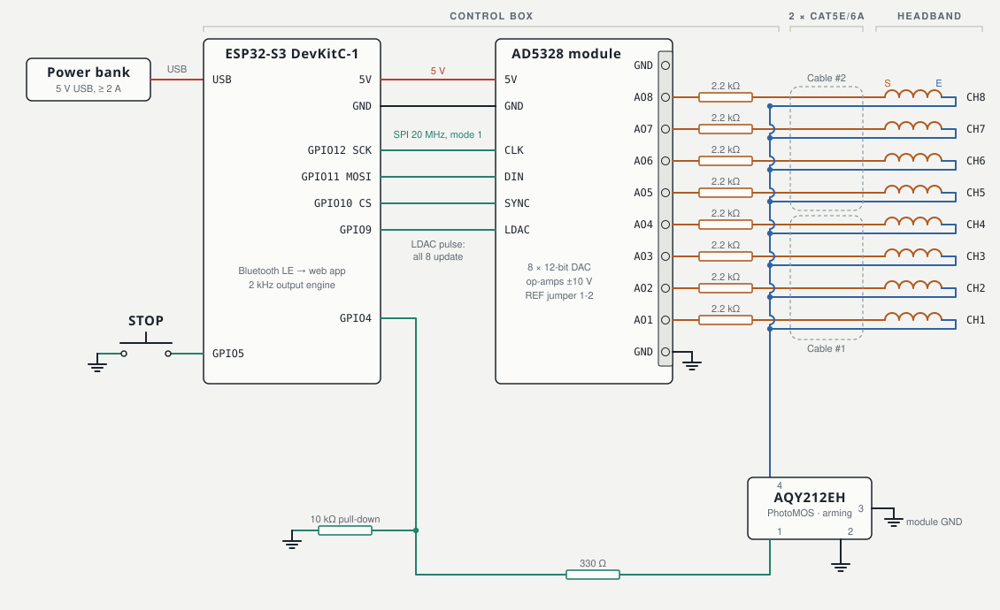

# God Helmet: 8-coil weak-field headset (ESP32 + AD5328 + web app over Bluetooth or USB)

A DIY recreation of the Persinger/Koren "God Helmet", the 8-coil Shakti and the circumcerebral "Octopus":
- 8 small coils on a Velcro headband;
- an AD5328 8-channel ±10 V DAC;
- an ESP32 that runs the signals in real time: ESP32-S3, classic ESP32, ESP32-C3 or ESP32-C6, without a display;
- a **Vue web app on GitHub Pages** that connects over **Bluetooth LE** or a **USB cable**, and installs the firmware;
- or, without phone or computer, a **2.8" touchscreen board** that runs the programs from its microSD card ([docs/STANDALONE.md](docs/STANDALONE.md)).

It ships **198 programs** built from fact-checked research: Todd Murphy's Shiva and Shakti sessions on their exact 10-10 sites (with reversed-polarity coils where the Shakti wiring needs them), 38 Persinger-lab protocols (sensed presence, Thomas pulse, circumcerebral rotations, Swann remote viewing, telepathy), the timing of clinical low-field methods (LFMS, T-PEMF, Cnp, theta-burst, BHFS), and replications of the independent tests. Each program states the evidence for the original protocol and what it approximates. Each program's page also has a **Brain** tab that shows where each program's field goes on a 3D brain, **30 guided sessions** with beat audio and questionnaires, and the means to **test it all honestly**:
- blinded real/sham sessions;
- hash-committed, blind-judged remote-viewing and telepathy trials with exact statistics.

> **Read [docs/SAFETY.md](docs/SAFETY.md) first.** Not for people with epilepsy or seizure history, psychiatric conditions, or implanted electronics. Battery power only. Experimental, non-medical.
>
> **Honest expectations.** The fields are about 1–8 µT at the cortex, about a million times weaker than TMS, and the induced electric field is microvolts to millivolts per metre. The best double-blind test (Granqvist 2005, N = 89) found no effect of the field; suggestibility predicted the experiences. See [docs/RESEARCH.md](docs/RESEARCH.md).



## How it fits together

```
 phone / laptop browser                     control box                                  headband
 ┌──────────────────────┐ Bluetooth / USB┌──────────────┐  SPI + LDAC  ┌──────────┐ 2.2 kΩ ×8  ┌─────────┐
 │ web app (GitHub      │◄──────────────►│  ESP32       │─────────────►│ AD5328   │──────────► │ 8 coils │
 │ Pages): programs,    │  JSON-RPC +    │  2 kHz engine│              │ ±10 V ×8 │◄─ returns ─│         │
 │ placement, trials    │  live status   │  log, trials │  PhotoMOS ◄──┤          │  PhotoMOS  └─────────┘
 └──────────────────────┘                └──────────────┘  STOP button └──────────┘
```

- **The app** (tabs: Programs, Guides, Trials, Log, Helmet, Docs) holds:
  - the program library, searchable, browsed by category, by placement (all 54 placements in use), by scalp site (a site explorer for every 10-10 site) or by the experience a program aims at;
  - a page for each program with tabs:
    - **Overview:** phases, waveforms and an in-browser preview of the coil activity;
    - **Placement:** the coils on a head map from above and from both sides, and a coil-by-coil checklist with tape-measure directions in centimetres for your head;
    - **Brain:** estimated field per brain region (cored-coil model on the Brainnetome and CerebrA atlases), what electrode or TMS stimulation of each region produced, and the claims made for it;
    - **Sources:** the evidence level and the sources;
  - a Start panel on each program page that lists what is ready (connection, safety page, head measured, coils placed, calibration, time since the last session);
  - guided sessions (Gateway-style, remote viewing, ESP training, sleep) with binaural, monaural or isochronic audio, a blinded helmet arm and questionnaires;
  - blinded remote-viewing and telepathy trials with their picture pool (Trials), and calibration, the wiring check, settings and firmware install (Helmet);
  - all documentation (the Docs tab renders `docs/*.md` and a reference of every program).

  It has a **demo mode** that runs the same engine in the browser, so everything can be explored without hardware.
- **The helmet** holds:
  - the real-time engine, with all 8 coils updated together at 2 kHz;
  - the hidden blind choices (real/sham, RV target, with SHA-256 commitments);
  - the session and trial log;
  - the safety interlocks: STOP button, arming switch, field ceiling, 60-min cap.

  A running session continues if the phone or computer disconnects.

## What's here

| Path | Contents |
|---|---|
| [docs/RESEARCH.md](docs/RESEARCH.md) | The evidence review: Persinger lab, independent tests, Murphy's claims, mainstream low-field science, psi evidence, **states → brain regions → helmet protocols**, lecture notes |
| [docs/HISTORY.md](docs/HISTORY.md) | Military, intelligence and health-agency history: ELF research, remote-viewing programmes, Gateway, the replication controversy, WHO/IARC/ICNIRP |
| [docs/SIGNALS.md](docs/SIGNALS.md) | What the coils play: coil physics and ICNIRP compliance, the Persinger-lab signals rebuilt from primary sources, Murphy's signal families, clinical timings |
| [docs/PRESET_FORMAT.md](docs/PRESET_FORMAT.md) | The program file format, every signal and coil mode, the pulse-table generators, the preset checker |
| [docs/BRAIN_VIEW.md](docs/BRAIN_VIEW.md) | How the brain view's field map is computed, its accuracy, data and licences |
| [docs/GUIDES.md](docs/GUIDES.md), [docs/QUESTIONNAIRES.md](docs/QUESTIONNAIRES.md) | Guided-session format, audio engine, questionnaires and scoring |
| [docs/WIRING.md](docs/WIRING.md) | Schematic, coil leads (inner = signal, outer = return), pin tables (S3, classic ESP32, C3, C6, 2.8" display board), arming switch, Cat6A pair mapping |
| [docs/STANDALONE.md](docs/STANDALONE.md) | The 2.8" touchscreen board without the app: flashing, the SD-card program pack, clock, screens |
| [docs/PLACEMENT.md](docs/PLACEMENT.md) | The 10-10 system, finding sites with a tape measure, the standard and program-specific layouts, depth and field per target |
| [docs/CALIBRATION.md](docs/CALIBRATION.md) | Bench test of the module, wiring checks, µT/mA calibration with a phone |
| [docs/EXPERIMENTS.md](docs/EXPERIMENTS.md) | Blinded sessions, remote-viewing and telepathy protocols, statistics |
| [docs/BLE_PROTOCOL.md](docs/BLE_PROTOCOL.md) | GATT service, framing, the USB line protocol, operations, session JSON, trial commitment |
| [docs/SAFETY.md](docs/SAFETY.md) | Contraindications, rules, built-in safeguards |
| [presets/](presets) | The 198 programs (JSON), shared by the app and the firmware tests |
| [guides/](guides) | The 30 guided sessions (JSON) |
| [firmware/](firmware) | PlatformIO project: engine, Bluetooth and USB transports, experiments, log |
| [webapp/](webapp) | Vue 3 + Vite app, deployed to GitHub Pages by `.github/workflows/pages.yml` |
| [hardware/](hardware) | Bill of materials, coil clip (OpenSCAD), schematic generator |
| [tools/](tools) | Python: coil field estimate, point tables, WAV → table, calibration fit, trial statistics; Node: brain-view asset builder |

## Quick start

### Supported boards

| Board | Chip | Bluetooth | USB | Display | Firmware env |
|---|---|---|---|---|---|
| ESP32-S3-DevKitC-1 (N8R8 / N16R8, 8 MB flash) | ESP32-S3 | yes | yes | – | `esp32s3` |
| ESP32 DevKitC (WROOM-32, 4 MB) | ESP32 | yes | yes | – | `esp32dev` |
| ESP32-C3-DevKitM-1, C3 Super Mini (4 MB) | ESP32-C3 | yes | yes | – | `esp32c3` |
| ESP32-C6-DevKitC-1 and other C6 boards (4 MB or more) | ESP32-C6 | yes | yes | – | `esp32c6` |
| 2.8" ESP32-32E display board | ESP32 | optional | yes | touchscreen | `esp32e_lcd28` |

Pins for each board: [docs/WIRING.md](docs/WIRING.md).

**Install from the app** (no other software): Helmet → **Install the firmware**, in Chrome or Edge on a computer, with the board on USB. It recognises the chip and asks before erasing.

**Firmware** ([PlatformIO](https://platformio.org/)):

```sh
cd firmware
./test/run_host_tests.sh      # engine, JSON, BLE framing, every preset rendered at 2 kHz
pio run -e esp32s3 -t upload  # ESP32-S3-DevKitC-1 (-e esp32dev, -e esp32c3, -e esp32c6; -e esp32e_lcd28: 2.8" display board)
pio device monitor            # prints the Bluetooth name, e.g. GodHelmet-3F2A
scripts/web_bundle.sh ../webapp/public/firmware   # images + manifests for the app's installer (CI does this)
```

Standalone touchscreen board: `pio run -e esp32e_lcd28 -t upload`, then `npm run sd-pack -- <dir>` in `webapp/` for the SD card ([docs/STANDALONE.md](docs/STANDALONE.md)).

**App:**

```sh
cd webapp
npm install
npm test                      # JS engine matches the C++ engine; field model; guides; protocol and trial logic
node scripts/check-preset.mjs --all   # validate every program file
node scripts/table.mjs list            # exact pulse tables (theta-burst, Thomas, LFMS, ...)
npm run dev                   # http://localhost:5173 (Web Bluetooth and Web Serial work on localhost)
```

**Deploy:** push to GitHub, then Settings → Pages → Source: **GitHub Actions**. The app appears at `https://<user>.github.io/<repo>/`.

**First use:**
1. Open the app in Chrome/Edge (iPhone: Bluefy) and press **Bluetooth**, or plug the helmet into the computer and press **USB**.
2. Read and accept **Safety**.
3. Do the bench test and calibration (docs/CALIBRATION.md) before wearing the helmet.

## Status

- **Verified here:**
  - all five firmware targets build;
  - host unit tests pass;
  - the JavaScript engine reproduces the C++ engine's output for every preset (whole sessions plus a 3.5 ms-resolution window);
  - protocol, blind reveal and trial commitment logic are tested against the demo helmet;
  - the app builds and runs in a headless browser in demo mode.
- **Not yet verified on hardware:**
  - BLE with a real phone;
  - the module's transfer function;
  - SPI/LDAC timing;
  - the coils' real µT/mA.

  docs/CALIBRATION.md walks through them.
