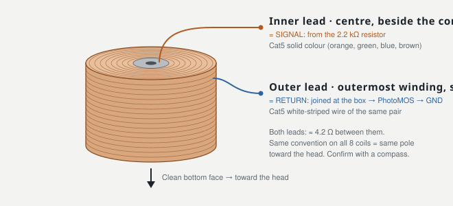

# Wiring


Regenerate both drawings with `python3 hardware/make_schematic.py`.

## Coil leads: which is signal, which is return



A coil has no polarity of its own; what matters is that all eight are wired the same way round, so they all present the same magnetic pole to the head.

- **Inner lead** (leaves the top face at the centre, beside the core) = **signal**, from the 2.2 kΩ resistor, on the solid-colour wire of the Cat5 pair.
- **Outer lead** (leaves the outermost winding at the side) = **return**, on the white-striped wire of the same pair, back to the return bus.

The outer winding is the layer that touches fingers, scalp and neighbouring wires, so it goes on the return (ground) side. Before soldering:
- Scrape or burn off the enamel on the last 5 mm.
- Check ≈ 4.2 Ω between the leads.
- Mark the inner lead.

## Block diagram

```
                       ┌──────────────── control box ─────────────────┐
 USB power bank 5 V ──►│ 5V ─┬─ ESP32-S3 DevKitC-1 (5V pin)             │
 (never mains while    │     └─ AD5328 module 5V   (≤ 5.5 V!)           │
  the helmet is worn)  │ GND ── common ground                           │
                       │                                                │
                       │ GPIO12 SCK  ───► module CLK                    │
                       │ GPIO11 MOSI ───► module DIN                    │
                       │ GPIO10 CS   ───► module SYNC                   │
                       │ GPIO9       ───► module LDAC                   │
                       │ GND         ───► module GND (header)           │
                       │                                                │
                       │ module AO1..AO8 ─[2.2 kΩ]×8─► RJ45 #1/#2 (A)   │      Cat5e        ┌─ headband ─┐
                       │ RJ45 returns (B) ─► PhotoMOS ─► module GND     │═══════════════════│ 8 coils    │
                       │                                                │  2 × 4 pairs      └────────────┘
                       │ GPIO4 ─330 Ω─► PhotoMOS LED (+10 kΩ pull-down to GND)
                       │ GPIO5 ◄── STOP button ── GND                   │
                       └────────────────────────────────────────────────┘
        Bluetooth LE ◄──► phone / laptop browser (web app on GitHub Pages)
```

## Pin table

The default board is the **ESP32-S3-DevKitC-1** (N8R8/N16R8, firmware env `esp32s3`). A classic **ESP32 DevKitC** works too (env `esp32dev`) with the pins in the last column.

| Function | ESP32-S3 | Direction | Connects to | ESP32 classic |
|---|---|---|---|---|
| SPI clock, 20 MHz, mode 1 | GPIO12 | out | AD5328 module **CLK** | GPIO18 |
| SPI data | GPIO11 | out | module **DIN** | GPIO23 |
| Frame select, high between every 16-bit word | GPIO10 | out | module **SYNC** | GPIO5 |
| Pulsed low after the 8 words: all coils change at the same instant | GPIO9 | out | module **LDAC** | GPIO17 |
| **Arming switch** (add a 10 kΩ pull-down so it stays off during boot/reset) | GPIO4 | out | PhotoMOS LED via 330 Ω | GPIO26 |
| STOP button to GND; interrupt opens the coil return immediately | GPIO5 | in | push button | GPIO27 |
| Status LED: blue blink idle, steady blue app connected, amber session (also during sham) | on-board RGB (GPIO48) | out | – | GPIO2 |
| Module supply (max 5.5 V) | 5V pin | power | module **5V** | 5V / VIN |
| Common ground | GND | – | module **GND** (header and output terminal) | GND |

On the S3 the pins avoid the strapping pins (0, 3, 45, 46), USB (19, 20) and the pins the octal flash/PSRAM uses on N8R8/N16R8 modules (26–37). The module's logic level is 3.3 V, so no level shifter is needed. Set the module's reference jumper to **1-2 (onboard 2.5 V)**.

## One output channel (×8)

```
 AD5328 module                control box                 Cat5 pair            coil
 AOx  ───────────────[ R 2.2 kΩ 1% ¼W ]───────────────── wire A (solid colour) ──► INNER lead (S)
                                                                                     │ 495 turns, 4.2 Ω, 4.1 mH
 GND  ──── PhotoMOS (AQY212EH, pins 3/4) ──┬──────────── wire B (white-striped) ◄── OUTER lead (E)
                                           └── all 8 "B" wires joined here
```

**Why the resistor is not optional.**
- The coil is 4.2 Ω. Without the resistor, ±10 V would try to push 2.4 A through it, a dead short for the module's output op-amps and about 100× the intended field.
- With 2.2 kΩ, current is at most 10 V / 2204 Ω = **4.54 mA**: about 3–6 µT at the cortex and about 100 µT at the coil face.
- Resistor dissipation is at most 45 mW.
- Inductance: τ = L/R = 1.9 µs, so the coil behaves as a resistor at these frequencies and no flyback diode is needed.

**Why the arming switch.**
- The AD5328 resets to code 0. On this ±10 V module that is almost certainly **−10 V on every output** until the firmware writes mid-scale (verify this in the bench test, docs/CALIBRATION.md §1).
- The PhotoMOS keeps the coil return open until then. It also opens instantly on the STOP button and on any reset.
- AQY212EH: 60 V / 500 mA, bidirectional, silent. It is a 4-pin DIP: pin 1 LED +, pin 2 LED −, pins 3/4 the switch (pin 4 to the return bus, pin 3 to module GND).
- A 5 V relay module also works if it has an input pull-down and is active-high. A click is fine, because the switch closes for real and for sham sessions alike.
- Don't use the AD5328's own power-down mode as an "off" switch: it floats the DAC outputs into the module's op-amp stage, so the module output is undefined.

**Twisted pairs.** Each coil's go and return currents run side by side, so the cable produces no field of its own. Two Cat5e cables carry 8 coils; RJ45 jacks on box and headband make the headband detachable. Keep the colour convention identical for all eight pairs (T568B: signal on pins 2/6/4/8, return on 1/3/5/7):

| Channel | Cable | Pair | RJ45 pin signal / return | Ring | Temporal |
|---|---|---|---|---|---|
| CH1 | #1 | orange | 2 / 1 | Fpz | FT7 |
| CH2 | #1 | green | 6 / 3 | F7 | T7 |
| CH3 | #1 | blue | 4 / 5 | T7 | CP5 |
| CH4 | #1 | brown | 8 / 7 | P7 | TP7 |
| CH5 | #2 | orange | 2 / 1 | Oz | FT8 |
| CH6 | #2 | green | 6 / 3 | P8 | T8 |
| CH7 | #2 | blue | 4 / 5 | T8 | CP6 |
| CH8 | #2 | brown | 8 / 7 | F8 | TP8 |

## Power budget

| Load | Current at 5 V |
|---|---|
| ESP32-S3 with Bluetooth LE | 60–150 mA |
| AD5328 module incl. its ±12 V converter | ~50–150 mA |
| 8 coils at full scale (36 mA from the ±12 V rails) | ~100 mA |

A 5 V / 2 A power bank is plenty. Some banks switch off at low load; if yours does, use one with an "always on" / low-current mode.

## Assembly checklist

1. Bench-test the module **without** coils (docs/CALIBRATION.md §1).
2. Solder the 8 resistors on perfboard between the module's terminal block and the RJ45 jacks.
3. Wire the PhotoMOS in the common return. Check with a meter that the return is open when the ESP32 is unpowered.
4. Fit the STOP button where you can reach it blind (on the cable or a hand-held puck).
5. Prepare the coils (docs/PLACEMENT.md) and mark each inner (signal) lead.
6. Power up and run the "slow rotation test" (Setup tab). Measure ~2.2 V across each resistor per mA, one channel at a time, in CCW order.
7. Polarity: run the DC test on each coil with a compass in front of it. All coils must show the **same** pole toward the head.
