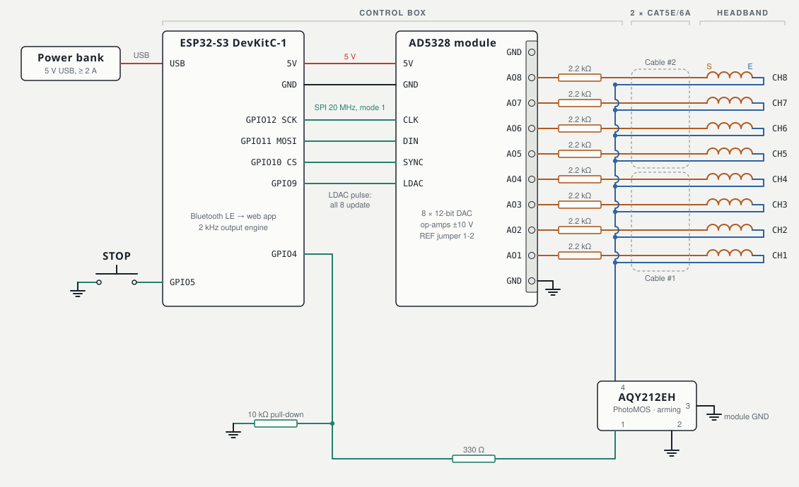
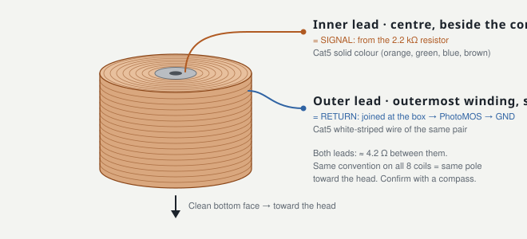

# Wiring



Regenerate both drawings with `python3 hardware/make_schematic.py`.

## Coil leads: which is signal, which is return



A coil has no polarity of its own; what matters is that all eight are wired the same way round, so they all present the same magnetic pole to the head.

- **Inner lead** (leaves the top face at the centre, beside the core) = **signal**, from the 2.2 kΩ resistor, on the strong-colour wire of a cable pair (orange, green, blue, brown).
- **Outer lead** (leaves the outermost winding at the side) = **return**, on the pale or white-striped wire of the same pair, back to the return bus.

The outer winding is the layer that touches fingers, scalp and neighbouring wires, so it goes on the return (ground) side. Before soldering:
- Scrape or burn off the enamel on the last 5 mm.
- Check ≈ 4.2 Ω between the leads.
- Mark the inner lead.

## Block diagram

```
                       ┌──────────────── control box ─────────────────┐
 USB power bank 5 V ──►│ 5V ─┬─ ESP32-S3 DevKitC-1 (5V pin)             │
 (never mains while    │     └─ AD5328 module 5V   (≤ 5.5 V!)           │
  the helmet is worn)  │ GND ── common ground                           │
                       │                                                │
                       │ GPIO12 SCK  ───► module CLK                    │
                       │ GPIO11 MOSI ───► module DIN                    │
                       │ GPIO10 CS   ───► module SYNC                   │
                       │ GPIO9       ───► module LDAC                   │
                       │ GND         ───► module GND (header)           │
                       │                                                │
                       │ module AO1..AO8 ─[2.2 kΩ]×8─► RJ45 #1/#2 (A)   │      cable        ┌─ headband ─┐
                       │ RJ45 returns (B) ─► PhotoMOS ─► module GND     │═══════════════════│ 8 coils    │
                       │                                                │  2 × 4 pairs      └────────────┘
                       │ GPIO4 ─330 Ω─► PhotoMOS LED (+10 kΩ pull-down to GND)
                       │ GPIO5 ◄── STOP button ── GND                   │
                       └────────────────────────────────────────────────┘
        Bluetooth LE ◄──► phone / laptop browser (web app on GitHub Pages)
   or   USB cable    ◄──► computer browser (Chrome or Edge, Web Serial)
```

The diagram shows the ESP32-S3; the other chips use the pins in the table below.

## Pin table

The firmware runs on four ESP32 chips, each with its own fixed pins (firmware env in brackets). The default board is the **ESP32-S3-DevKitC-1** (N8R8/N16R8, `esp32s3`). A classic **ESP32 DevKitC** (`esp32dev`), an **ESP32-C3** board (DevKitM-1 or a "C3 Super Mini", `esp32c3`) and an **ESP32-C6** board (DevKitC-1, `esp32c6`) work the same way. Install from the web app (Helmet → Install the firmware; it recognises the chip) or with PlatformIO. For the **2.8" ESP32-32E display board** see [its own section](#esp32-32e-28-display-board) below.

| Function | ESP32-S3 | ESP32 classic | ESP32-C3 | ESP32-C6 | Direction | Connects to |
|---|---|---|---|---|---|---|
| SPI clock, 20 MHz, mode 1 | GPIO12 | GPIO18 | GPIO4 | GPIO21 | out | AD5328 module **CLK** |
| SPI data | GPIO11 | GPIO23 | GPIO6 | GPIO19 | out | module **DIN** |
| Frame select, high between every 16-bit word | GPIO10 | GPIO5 | GPIO7 | GPIO18 | out | module **SYNC** |
| Pulsed low after the 8 words: all coils change at the same instant | GPIO9 | GPIO17 | GPIO5 | GPIO20 | out | module **LDAC** |
| **Arming switch** (add a 10 kΩ pull-down so it stays off during boot/reset) | GPIO4 | GPIO26 | GPIO10 | GPIO22 | out | PhotoMOS LED via 330 Ω |
| STOP button to GND; interrupt opens the coil return immediately | GPIO5 | GPIO27 | GPIO3 | GPIO23 | in | push button |
| The board's **BOOT** button is a second STOP (it counts once held for 40 ms) | GPIO0 | GPIO0 | GPIO9 | GPIO9 | in | (on the board) |
| Status LED: blue blink idle, steady blue app connected (Bluetooth or USB), amber session (also during sham) | on-board RGB (GPIO48) | GPIO2 | on-board RGB (GPIO8) | on-board RGB (GPIO8) | out | – |
| Module supply (max 5.5 V) | 5V pin | 5V / VIN | 5V | 5V | power | module **5V** |
| Common ground | GND | GND | GND | GND | – | module **GND** (header and output terminal) |

The pins avoid each chip's strapping pins, USB pins, UART pins and flash pins:
- **S3:** strapping 0, 3, 45, 46; USB 19, 20; the octal flash/PSRAM of N8R8/N16R8 modules, 26–37.
- **C3:** strapping 2, 8, 9; USB 18, 19; UART 20, 21; flash 12–17.
- **C6:** strapping 4, 5, 8, 9, 15; USB 12, 13; UART 16, 17; flash 24–30.

The module's logic level is 3.3 V, so no level shifter is needed. Set the module's reference jumper to **1-2 (onboard 2.5 V)**.

**USB:** the web app can also control the helmet over the USB cable instead of Bluetooth: the **USB** button, Chrome or Edge on a computer. On the S3, C3 and C6 both sockets work: the chip's own USB and the one with the bridge chip. The C3 and C6 have one core, which the 2 kHz output loop shares with Bluetooth. The live status shows `overruns` if it ever falls behind.

## ESP32-32E 2.8" display board

The "2.8inch ESP32-32E Display" (LCDwiki E32R28T / E32N28T, often sold as a "Cheap Yellow Display") has a classic ESP32 (ESP32-D0WD-V3, 4 MB flash, no PSRAM). With firmware env **`esp32e_lcd28`** it runs **standalone**: programs from the microSD card, chosen and started on the touchscreen, no phone or computer needed ([STANDALONE.md](STANDALONE.md)). Bluetooth for the web app is an optional setting.

Almost every pin already drives the display, touch, SD card, speaker or RGB LED ([LCDwiki pin table](https://www.lcdwiki.com/2.8inch_ESP32-32E_Display)). The module goes on the 4-pin SPI peripheral header and one ground wire:

| Board connector · pin | GPIO | Connects to | Notes |
|---|---|---|---|
| SPI header · IO18 (SCK) | 18 | module **CLK** | shared with the microSD card |
| SPI header · IO23 (MOSI) | 23 | module **DIN** | shared with the microSD card |
| SPI header · IO27 (CS) | 27 | module **SYNC** | |
| SPI header · IO19 (MISO) | 19 | – (leave free) | the microSD card's data line; the AD5328 never sends data |
| Expansion header · 3.3V | – | module **LDAC** | no pin is left for LDAC: tied high, the firmware updates all 8 outputs at once with the AD5328's software "single update" word |
| Expansion header · GND | – | module **GND** | the SPI header has no ground pin: this wire is the common ground |
| BOOT button (on the board) | 0 | – | **STOP** (as the red button on the screen; counts once held for 40 ms) |
| USB-C | – | power bank, 5 V | |

This board has **no arming switch** and **no external STOP button**: the coil returns go straight to the module's GND, and STOP is the on-screen button or the BOOT button. The on-screen button stops the field at once (the sequencer writes 0 V to all eight outputs within 0.5 ms); the BOOT button does so once it has been held for 40 ms, because opening the board's USB port pulses that pin.

**Power-on rule.** The AD5328 starts at code 0, which on the ±10 V module is about −10 V on every output (up to 4.5 mA per coil through the 2.2 kΩ resistors) until the firmware sets 0 V, a fraction of a second after power-on. A reset holds whatever the outputs had. So:
- Power the board and the module, **wait for the screen**, then put the helmet on.
- **Never flash, reset or plug USB into a computer with the helmet on.** Take it off first.
- Feed board and module from the same power bank, so they lose power together.

Notes:
- **Module 5 V.** The board has no documented 5 V output. Feed the module's 5V/GND terminal from the same power bank (a USB splitter or a second USB port), and connect the grounds through the expansion header GND. The board's LiPo connector cannot power the module (no 5 V).
- **The board cannot detect the module** (the AD5328 has no data-out pin). The first start after each power-on asks you to confirm it, and **Settings → Module check** tests it with a multimeter ([STANDALONE.md](STANDALONE.md)).
- **microSD card in the slot:** it holds the program library (FAT32, any size; [STANDALONE.md](STANDALONE.md)). It shares SCK/MOSI/MISO with the module, so the firmware reads it only while no session runs.
- **The firmware keeps the board quiet:** speaker amplifier off (IO4 high); during a session the screen stays on, dims or goes dark after 10 s (a setting). The RGB LED shows a dim status: blue blink idle, steady blue with the app connected, amber during a session.
- **SPI wiring stays short** (under about 20 cm): the bus runs at 20 MHz to the module and 10 MHz to the card. Twist each signal wire with a ground wire if it must be longer.
- Logic is 3.3 V, which the module accepts directly, as on the other boards.

## The AD5328 module ("AD5328模块 V1.2")

What the board itself shows (silkscreen and parts, from photos of a V1.2 board):

| Connector | Order on the board | Use |
|---|---|---|
| Output terminal block (10 screws) | GND, AO8, AO7, AO6, AO5, AO4, AO3, AO2, AO1, GND | AOx → 2.2 kΩ → coil; either GND screw is the module ground |
| Logic header H1 (6 pins) | 5V, GND, CLK, DIN, SYNC, LDAC | To the ESP32 (pin table above). CLK, DIN and SYNC pass a 100 Ω resistor array (RN1) on the board |
| Power terminal (2 screws) | 5V, GND | The same 5 V as H1; use one of them, not both from different supplies |
| Reference jumper (3 pins, "基准源") | 1 = 2V5, 2 = EX, 3 = GND | **1-2: onboard 2.5 V reference (use this).** Pin 2 alone is the external-reference input. Never bridge 2-3: it shorts the reference to ground |
| Test pads | 5V, 12V, −12V, VREF, GND | Bench checks (docs/CALIBRATION.md §1) |

Parts:
- **DAC:** AD5328BRU (TSSOP-16). The date code on the one photographed is 0331 (2003): old stock or a recovered part, so run the bench test before trusting it.
- **Output amplifiers:** four SGMicro SGM8272 dual op-amps (one amplifier per channel), rated for supplies up to ±18 V ([SGM8272](https://sg-micro.com/product/SGM8272)).
- **Supply:** an on-board DC-DC converter followed by 78L12 and 79L12 regulators makes ±12 V for the op-amps; LED1 is the power light.
- **Per channel:** 3 kΩ, 12 kΩ, 30 kΩ and 120 kΩ resistors (codes 302, 123, 303, 124), both pairs in a 1 : 4 ratio. That is a difference amplifier with a gain of 4 between the DAC output and the 2.5 V reference: **V_out = ±4 · (V_DAC − 2.5 V)**. With the DAC set to 0–5 V (GAIN ×2, the firmware default), code 0x800 gives 0 V and the full range is ±10 V. Which input the DAC feeds, and so the sign, cannot be seen from the photos; the bench test shows it. Code 0 (the DAC's power-on state) gives −10 V (or +10 V) on every output, not 0 V, which is why the DevKit boards use the arming switch (the display board instead follows a power-on rule, see above).

## One output channel (×8)

```
 AD5328 module                control box                 cable pair           coil
 AOx  ───────────────[ R 2.2 kΩ 1% ¼W ]───────────────── wire A (strong colour) ─► INNER lead (S)
                                                                                     │ 495 turns, 4.2 Ω, 4.1 mH
 GND  ──── PhotoMOS (AQY212EH, pins 3/4) ──┬──────────── wire B (pale partner) ◄─── OUTER lead (E)
                                           └── all 8 "B" wires joined here
```

**Why the resistor is not optional.**
- The coil is 4.2 Ω. Without the resistor, ±10 V would try to push 2.4 A through it, a dead short for the module's output op-amps and about 100× the intended field.
- With 2.2 kΩ, current is at most 10 V / 2204 Ω = **4.54 mA**: about 3–6 µT at the cortex and about 100 µT at the coil face.
- Resistor dissipation is at most 45 mW.

**Maximum current per pin.**

| Pin | Case | Current |
|---|---|---|
| AO1–AO8 → 2.2 kΩ → coil | Full scale: ±9.995 V over 2204 Ω (resistor + coil + 2 m of cable) | **4.53 mA** (45 mW in the resistor, 0.09 mW in the coil) |
| AO1–AO8 | Tolerances: resistor 1 % low, module gain or reference high (its resistors are 3-digit-code parts, probably 5 %), output ±10.5 V | about 4.8 mA |
| AO1–AO8 | Fault: amplifier stuck at its rail, about ±11 V on the ±12 V supply | about **5.0 mA, the hard ceiling** (≈ 9.4 µT at 20 mm, 55 mW in the resistor) |
| AO1–AO8 without the resistor | Never: ±10 V into 4.2 Ω | limited only by the op-amp's short-circuit current, about 100× the intended field |
| All 8 outputs together | Same sign, full scale | 36 mA from one ±12 V rail (78L12/79L12: 100 mA) |
| GPIO4 → 330 Ω → PhotoMOS LED | (3.3 V − 1.2 V) / 330 Ω | about 6 mA: enough to switch the AQY212EH reliably, well under the ESP32's 20 mA default drive |
| IO19 on the 2.8" display board | the same LED plus the 1 kΩ pull-down (3.3 mA) | about 9.5 mA, still under the 20 mA default drive |
| CLK, DIN, SYNC, LDAC, STOP | Logic inputs | microamps (STOP: about 0.07 mA through the internal pull-up when pressed) |

- Inductance: τ = L/R = 1.9 µs, so the coil behaves as a resistor at these frequencies and no flyback diode is needed.

**Why the arming switch** (DevKit boards; the ESP32-32E display board has none and relies on its power-on rule, see [above](#esp32-32e-28-display-board)).
- The AD5328 resets to code 0. On this ±10 V module that is almost certainly **−10 V on every output** until the firmware writes mid-scale (verify this in the bench test, docs/CALIBRATION.md §1).
- The PhotoMOS keeps the coil return open until then. It also opens instantly on the STOP button and on any reset.
- AQY212EH: 60 V / 500 mA, bidirectional, silent. It is a 4-pin DIP: pin 1 LED +, pin 2 LED −, pins 3/4 the switch (pin 4 to the return bus, pin 3 to module GND).
- A 5 V relay module also works if it has an input pull-down and is active-high. A click is fine, because the switch closes for real and for sham sessions alike.
- Don't use the AD5328's own power-down mode as an "off" switch: it floats the DAC outputs into the module's op-amp stage, so the module output is undefined.

**Twisted pairs.** Each coil's go and return currents run side by side, so the cable produces no field of its own. Two network cables (Cat5e, Cat6 or Cat6A) carry 8 coils, 4 pairs each; RJ45 jacks on box and headband make the headband detachable. Keep the colour convention identical for all eight pairs (T568B: signal on pins 2/6/4/8, return on 1/3/5/7).

### Cable colours

Each pair is one strong colour twisted with a pale partner. Classic Cat5e marks the partner with white stripes (white/orange …). Many Cat6/Cat6A cables use plain pastel colours instead, for example:

| Pair | Signal wire (coil inner lead) | Return wire (coil outer lead), Cat6A pastel | … or classic Cat5e |
|---|---|---|---|
| orange | orange | white | white/orange |
| green | green | light green | white/green |
| blue | blue | light blue | white/blue |
| brown | brown | pink (light brown) | white/brown |

Find the pairs by the twist: the two wires of a pair wind around each other all the way along the cable. If in doubt, check with a meter from end to end before soldering.

| Channel | Cable | Pair | Signal / return wire (Cat6A pastel) | RJ45 pin signal / return | Ring | Temporal |
|---|---|---|---|---|---|---|
| CH1 | #1 | orange | orange / white | 2 / 1 | Fpz | FT7 |
| CH2 | #1 | green | green / light green | 6 / 3 | F7 | T7 |
| CH3 | #1 | blue | blue / light blue | 4 / 5 | T7 | CP5 |
| CH4 | #1 | brown | brown / pink | 8 / 7 | P7 | TP7 |
| CH5 | #2 | orange | orange / white | 2 / 1 | Oz | FT8 |
| CH6 | #2 | green | green / light green | 6 / 3 | P8 | T8 |
| CH7 | #2 | blue | blue / light blue | 4 / 5 | T8 | CP6 |
| CH8 | #2 | brown | brown / pink | 8 / 7 | F8 | TP8 |

Cable #1 carries CH1–CH4 and cable #2 CH5–CH8. In the temporal layouts and the God Helmet / Shakti cross, CH1–4 are on the left and CH5–8 on the right, so run cable #1 to the left side of the band and cable #2 to the right.

### Cat6A notes

- **Never split a coil across two pairs.** If a coil's return comes back on a wire of another pair, its current loop opens up: the cable then makes its own field and couples into the neighbouring channels.
- **Solid 23 AWG conductors.** Cat6A wires are solid copper, about 0.07 Ω per metre: nothing next to the 2.2 kΩ resistor, so cable length does not change the field. Solid wire suits punch-down keystone jacks or soldering. RJ45 plugs must be rated for 23 AWG solid wire (Cat6A plugs); Cat5e plugs usually do not take it.
- **Solid wire breaks when it flexes at one spot.** Clamp the cable to the band and to the box (cable tie, clip or a dab of hot glue) so head movement bends the jacket, not the wires at the solder joints. From the clamp to each coil, use short stranded leads.
- **Ends.** Cut off the plastic cross (the pair separator) at the end and untwist each pair no more than about 1 cm.
- **Shielded Cat6A** (foil or braid under the jacket: F/UTP, S/FTP): connect the shield to GND at the box end only and leave it open at the headband. Unshielded Cat6A (U/UTP) needs nothing extra.
- **Stiffness.** Cat6A is thicker and stiffer than Cat5e. Run it down the back of the head, or change to a thin stranded cable at a junction on the band.

## Power budget

| Load | Current at 5 V |
|---|---|
| ESP32-S3 with Bluetooth LE | 60–150 mA |
| AD5328 module incl. its ±12 V converter | ~50–150 mA |
| 8 coils at full scale (36 mA from the ±12 V rails) | ~100 mA |

A 5 V / 2 A power bank is plenty. Some banks switch off at low load; if yours does, use one with an "always on" / low-current mode.

## Assembly checklist

1. Bench-test the module **without** coils (docs/CALIBRATION.md §1).
2. Solder the 8 resistors on perfboard between the module's terminal block and the RJ45 jacks.
3. Wire the PhotoMOS in the common return. Check with a meter that the return is open when the ESP32 is unpowered.
4. Fit the STOP button where you can reach it blind (on the cable or a hand-held puck).
5. Prepare the coils (docs/PLACEMENT.md) and mark each inner (signal) lead.
6. Power up and run the "slow rotation test" (Helmet tab). Measure ~2.2 V across each resistor per mA, one channel at a time, in CCW order.
7. Polarity: run the DC test on each coil with a compass in front of it. All coils must show the **same** pole toward the head.
